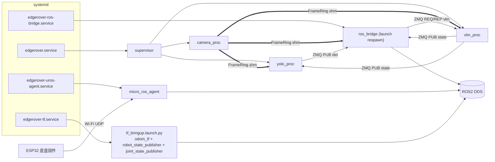
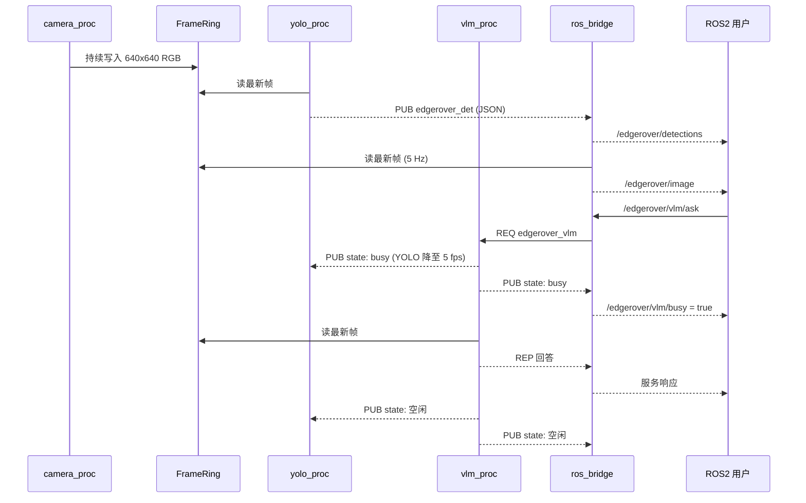
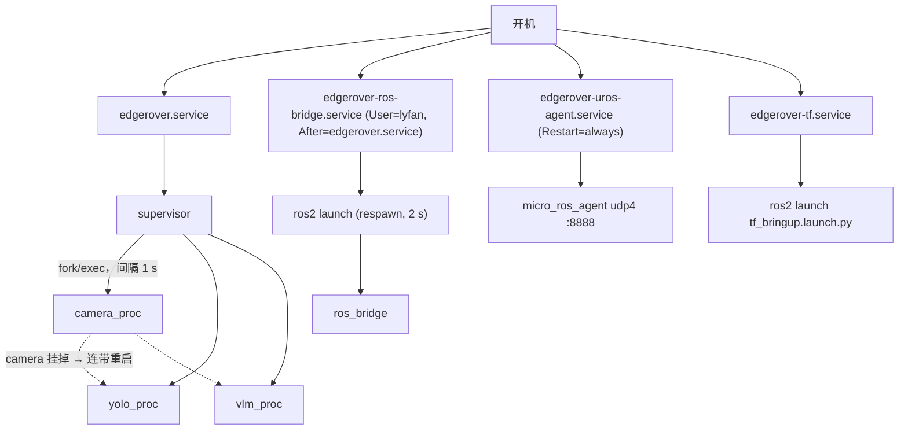

# EdgeRover 系统架构（当前实际状态）

> 更新：2026-11-21。只记录**已存在 / 已运行**的部分，计划功能单独列出。

**状态标记**

| 标记 | 含义 |
|---|---|
| ✅ | 已验证 |
| ⚠️ | 未验证（依据代码，尚未实测） |
| 🚧 | 未实现 |

**目录**

1. [总览](#1-总览)
2. [进程与 Package 职责](#2-进程与-package-职责)
3. [视觉数据流](#3-视觉数据流)
4. [通信职责划分](#4-通信职责划分)
5. [进程管理：systemd 与 supervisor](#5-进程管理systemd-与-supervisor)
6. [未实现 / 未验证汇总](#6-未实现--未验证汇总)

---

## 1. 总览

- 平台：RK3588，ROS2 Humble ✅，Ubuntu 22.04.5 LTS ✅（内核 6.12.69 aarch64）
- 工作区：`edge_rover/ros2_workspace`
- 模型目录：`edge_rover/model`

系统分三层：

| 层 | 组成 | 说明 |
|---|---|---|
| 视觉流水线 | camera → YOLO → VLM | 非 ROS 进程，由 supervisor 管理 |
| ROS2 桥 | `ros_bridge` | 视觉结果 ⇄ ROS2 话题/服务 |
| 底盘 | ESP32 固件 + micro-ROS agent | Wi-Fi UDP 接入 ROS2 |

---

## 2. 进程与 Package 职责

### 2.1 自研包（`src/`）

| Package | 进程 / 产物 | 状态 |
|---|---|---|
| `edgerover_ipc` | 库 `frame_ring` | ✅ |
| `edgerover_perception` | `camera_proc`、`frame_dump` | ✅ |
| `edgerover_yolo` | `yolo_proc`、`yolo_sub` | ✅ |
| `edgerover_vlm` | `vlm_proc`、`vlm_ask` | ✅ |
| `edgerover_supervisor` | `supervisor` | ✅ 运行 / ⚠️ 重启策略未实测 |
| `edgerover_ros_bridge` | `ros_bridge` | ✅ |
| `pkg_edgerover_camera` | 无 | — |
| `edgerover_navigation` | 无可执行文件；launch `slam_mapping.launch.py`（slam_toolbox 在线建图）、`nav2_bringup.launch.py`（Nav2 + AMCL 定位） | ✅ SLAM 2026-11-21 板上编译、建图实测；⚠️ Nav2 2026-11-22 已上板，开阔区域可用、窄通道受限；手动启动，不自启 |
| `edgerover_mission` | `mission_node`：`/edgerover/mission/target` → YOLO 找目标 → 视觉伺服接近 → 停车问 VLM → `/edgerover/mission/result` | ✅ 2026-11-22 板上编译、SEARCH/APPROACH 实测；⚠️ DESCRIBE 未跑到；与 Nav2 抢 `/cmd_vel`，二选一 |
| `pkg_edgerover_odom_tf` | `odom_tf_node`；launch `odom_tf.launch.py`、`tf_bringup.launch.py`（完整 TF 树） | ✅ 板上编译、TF 实测；✅ `edgerover-tf.service` 开机自启 |

各包职责：

- **`edgerover_ipc`**：FrameRing 共享内存环形帧缓冲（单写多读，seqlock）。
- **`edgerover_perception`**：采集 IMX415 → RGA 转 640x640 RGB → 写 FrameRing；`frame_dump` 调试用。
- **`edgerover_yolo`**：YOLOv5s 检测（NPU CORE_0），结果 JSON 经 ZMQ 发布；`yolo_sub` 调试用。
- **`edgerover_vlm`**：Qwen3-VL-2B 问答（rknn 视觉编码 + rkllm），ZMQ REP；`vlm_ask` 命令行提问。
- **`edgerover_supervisor`**：拉起、监控、重启视觉三进程。
- **`edgerover_ros_bridge`**：ZMQ/FrameRing ⇄ ROS2；自定义 `Stats.msg`、`VlmAsk.srv`。
- **`pkg_edgerover_camera`**：空脚手架，无源码，未使用。
- **`edgerover_navigation`**：导航相关 launch。`slam_mapping.launch.py` 建图（订阅 `/scan` + TF，发布 `/map` 与 `map→odom` TF，接口见 `interfaces.md` 第 10 节）；`nav2_bringup.launch.py` include apt 版 `nav2_bringup`，`slam:=False` 走 AMCL 定位 + 全局规划 + DWB 控制（见 `interfaces.md` 第 11 节）。
- **`edgerover_mission`**：任务节点 `mission_node`，不依赖 Nav2。收到目标类名后原地自转搜索，用 YOLO 检测框做视觉伺服接近，靠激光/框高判断到位后停车问 VLM（见 `interfaces.md` 第 12 节）。
- **`pkg_edgerover_odom_tf`**：订阅底盘 `/odom`，广播 `odom→base_footprint` TF（子 frame 由参数 `child_frame` 决定，launch 默认 `base_footprint`；固件只发消息不发 TF）。

### 2.2 第三方包（`src/third_party/`）

| Package | 职责 | 状态 |
|---|---|---|
| `micro-ROS-Agent`、`micro_ros_msgs` | 底盘接入 ROS2 的网关 | ✅ 连通、断线重连；✅ `edgerover-uros-agent.service` 开机自启 |
| `leap_interfaces` | 底盘服务 `/set_speed_pid`、`/get_speed_pid` | ✅ 已编译 / ⚠️ 未调用测试 |
| `chuyun_description` | URDF（含 `camera_link`） | ✅ 与 odom TF 联调通过（`view_frames` 完整树）；坐标系名与固件一致 |
| `chuyun_bringup`、`chuyun_navigation2` | bringup / Nav2 配置 | 🚧 未使用 |

### 2.3 底盘固件

不在本仓库：ESP-IDF 工程 `leap_ros_mcu_driver`，节点 `leap_low_driver`；agent 地址在底盘网页配置，存 NVS。

---

## 3. 视觉数据流

| 进程 | 输入 | 处理 | 输出 |
|---|---|---|---|
| `camera_proc` | `/dev/video44`，3840x2160 NV12 | RGA letterbox 缩放 + 转色 | FrameRing `/edgerover_frames`，4 slot，640x640 RGB888，附原图尺寸 |
| `yolo_proc` | FrameRing 最新帧（直接拷入 NPU 输入内存） | `yolov5s_rk3588.rknn`，NPU CORE_0 | ZMQ PUB `ipc:///tmp/edgerover_det`（JSON，HWM=2） |
| `vlm_proc` | ZMQ REP 提问 + FrameRing 最新帧 | 视觉编码器 rknn（默认 3 核）+ LLM rkllm（max_new=64，ctx=4096） | REP 回答；ZMQ PUB `ipc:///tmp/edgerover_state`（busy 状态） |
| `ros_bridge` | 上述 ZMQ + FrameRing | 格式转换 | ROS2 话题/服务（见[第 4 节](#4-通信职责划分)） |

### 资源仲裁

VLM 回答期间发布 busy，`yolo_proc` 收到后降到 5 fps，把 NPU/DDR 让给 VLM；busy 超过 60 s 视为 VLM 异常，YOLO 恢复全速。

> ⚠️ 降帧效果未做量化测试。

### 一次 VLM 提问的时序

---

## 4. 通信职责划分

| 机制 | 承担内容 | 原因 |
|---|---|---|
| **共享内存 FrameRing** | 仅图像帧；1 写（camera）3 读（yolo / vlm / bridge） | 数据量大，避免拷贝与序列化 |
| **ZMQ（`ipc://`）** | 进程间小消息：检测 JSON、VLM 问答、VLM 忙闲状态 | 轻量；视觉进程不依赖 ROS，可单独运行调试 |
| **ROS2** | 对外接口；底盘控制与传感 | 对接导航、RViz 等生态 |
| **micro-ROS（UDP）** | ESP32 ↔ agent | MCU 资源受限 |

### 4.1 ZMQ 端点

| 端点 | 模式 | 绑定方 | 连接方 |
|---|---|---|---|
| `ipc:///tmp/edgerover_det` | PUB/SUB | yolo_proc | ros_bridge |
| `ipc:///tmp/edgerover_vlm` | REQ/REP | vlm_proc | ros_bridge |
| `ipc:///tmp/edgerover_state` | PUB/SUB | vlm_proc | yolo_proc、ros_bridge |

### 4.2 ROS2 接口：视觉（提供方 ros_bridge）

| 名称 | 类型 | 说明 |
|---|---|---|
| `/edgerover/detections` | 话题 | `vision_msgs/Detection2DArray`，SensorDataQoS，坐标为 letterbox 640 |
| `/edgerover/image` | 话题 | `sensor_msgs/Image`，5 Hz，frame_id `camera_link` |
| `/edgerover/vlm/busy` | 话题 | `std_msgs/Bool`，transient_local，60 s 看门狗 |
| `/edgerover/stats` | 话题 | `Stats.msg`，1 Hz |
| `/edgerover/vlm/ask` | 服务 | `VlmAsk.srv`，超时 30 s |
| `/edgerover/mission/target`、`/edgerover/mission/result` | 话题 | `std_msgs/String`，任务输入 / 输出（`mission_node`），见 `interfaces.md` 第 12 节 |

### 4.3 ROS2 接口：底盘

| 名称 | 类型 | 方向 | 说明 |
|---|---|---|---|
| `/cmd_vel` | 话题 | 底盘订阅 | Twist（m/s），500 ms 无指令自动停车 ✅ |
| `/odom` | 话题 | 底盘发布 | 50 Hz ✅；固件只发消息不发 TF，TF 由 `pkg_edgerover_odom_tf` 补发 ✅ |
| `/scan` | 话题 | 底盘发布 | `sensor_msgs/LaserScan`，`laser_frame`，360 点 / 1°；✅ 2026-11-20 实测 8.6–8.8 Hz，约 35% 角度桶无数据（固件 `xQueuePeek` 重复发布，整帧实际约 6 Hz）；✅ 0° 朝车头；⚠️ 正角左右方向待确认 |
| `/imu`、`/battery_state`、`/ultrasonic` | 话题 | 底盘发布 | 已出现在话题列表中 ⚠️ 内容未核对 |
| `/set_speed_pid`、`/get_speed_pid` | 服务 | 底盘提供 | ⚠️ 未调用测试 |

桥接参数：`edgerover_ros_bridge/config/bridge.yaml`（端点、超时、帧率、shm 名均可配置）。

---

## 5. 进程管理：systemd 与 supervisor

### 5.1 各层职责

**systemd**

- 开机自启，保证 supervisor、bridge launch、micro_ros_agent、TF launch 存活。
- 单元文件副本：`deploy/systemd/`（安装到 `/etc/systemd/system/`）。
- 状态：✅ 四个服务 2026-11-20 重启后验证通过；✅ `/etc` 下安装的 `edgerover-tf.service` 与仓库副本 `sudo diff` 仅注释行差异。
- ⚠️ 开机约 30 s 内 `/odom` 时间戳比本机时钟偏 ~4.7 s，底盘重连后消失（详见 `development_notes.md` 7.1）。

**supervisor**

- 按 camera → yolo → vlm 顺序启动。
- 子进程退出后指数退避重启（1→30 s，稳定运行 60 s 清零）。
- camera 挂掉时连带重启下游。
- 退出时 SIGTERM，5 s 后 SIGKILL。
- 状态：✅ 运行 / ⚠️ 重启行为未做 kill 测试。

**launch respawn**

- bridge 崩溃后 2 s 重启。
- 状态：⚠️ 未做 kill 测试。

### 5.2 注意事项

- supervisor 默认路径：`$HOME/edge_rover/ros2_workspace/install` 与 `$HOME/edge_rover/model`（可用参数覆盖）。

> bridge **不归** supervisor 管。`After=` 只约束启动顺序；bridge 会自行重试 FrameRing 与 ZMQ 连接，因此不依赖视觉进程先就绪。

---

## 6. 未实现 / 未验证汇总

### 🚧 未实现
- [ ] `camera_view` 全屏摄像头预览未实现（设计要点见 `development_notes.md` 4.6）

### ⚠️ 未验证

- [ ] supervisor 退避重启、连带重启的实际表现
- [ ] VLM busy 时 YOLO 降帧的实测效果
- [ ] 底盘 `/imu`、`/battery_state`、`/ultrasonic` 内容；PID 服务（`/scan` 已核清，见 `interfaces.md` 8.2）
- [x] `chuyun_description` 坐标系名与固件是否一致：依据代码对照一致，2026-11-20 `view_frames` 实测 TF 树完整
- [ ] librknnrt / librkllmrt / librga / libzmq 版本
