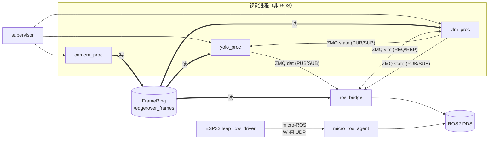
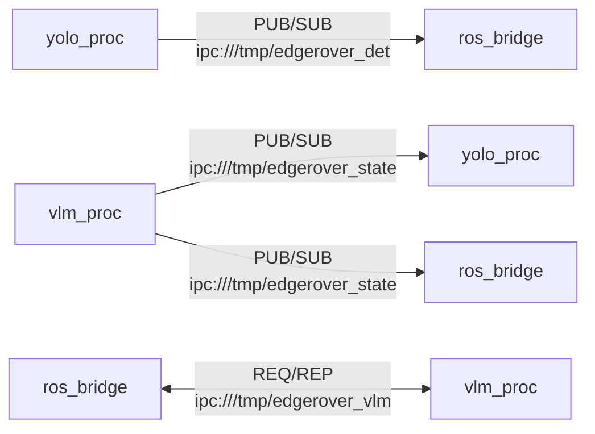
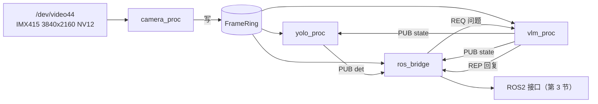
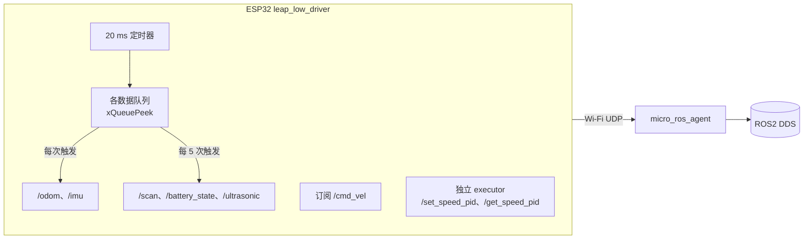

# EdgeRover 接口说明

> 更新：2026-11-23。只记录能从源码 / 配置确认的内容；无法确认的标 **待确认**。
> 默认值均可被参数 / 命令行覆盖。

**目录**

1. [文档说明与源码依据](#1-文档说明与源码依据)
2. [系统通信架构](#2-系统通信架构)
3. [ROS2 接口](#3-ros2-接口)
4. [共享内存 FrameRing](#4-共享内存-framering)
5. [ZMQ 通信接口](#5-zmq-通信接口)
6. [各进程职责与数据流](#6-各进程职责与数据流)
7. [bridge.yaml 参数配置](#7-bridgeyaml-参数配置)
8. [底盘 micro-ROS 接口](#8-底盘-micro-ros-接口)
9. [待确认事项与原文不一致](#9-待确认事项与原文不一致)
10. [SLAM 建图（slam_toolbox）](#10-slam-建图slam_toolbox)
11. [Nav2 导航](#11-nav2-导航)
12. [任务节点（edgerover_mission）](#12-任务节点edgerover_mission)

---

## 1. 文档说明与源码依据

### 1.1 状态用语

全文统一，不混用：

| 状态 | 含义 |
|---|---|
| **依据代码** | 只读源码得出，未实测 |
| **已验证** | 板上实测确认 |
| **标称值** | 代码中的设计值，实际可能更低（见 [8.1](#81-发布机制)） |
| **待确认** | 源码 / 配置中无法确定，汇总在[第 9 节](#9-待确认事项与原文不一致) |

### 1.2 源码位置

| 内容 | 路径 |
|---|---|
| 源码根 | `edge_rover/ros2_workspace/src/` |
| ROS2 桥 | `edgerover_ros_bridge/src/ros_bridge.cpp` |
| 自定义消息 / 服务 | `edgerover_ros_bridge/msg/Stats.msg`、`edgerover_ros_bridge/srv/VlmAsk.srv` |
| FrameRing | `edgerover_ipc/include/edgerover_ipc/frame_ring.hpp` |
| 桥接参数 | `edgerover_ros_bridge/config/bridge.yaml` |
| 底盘固件（不在本仓库） | `Y:\leap_demo\leap_ros_mcu_driver` |

---

## 2. 系统通信架构



| 通道 | 承载内容 | 章节 |
|---|---|---|
| FrameRing 共享内存 | 640x640 RGB888 图像帧 | [第 4 节](#4-共享内存-framering) |
| ZMQ `ipc://` | 检测 JSON、VLM 问答、VLM 忙闲状态 | [第 5 节](#5-zmq-通信接口) |
| ROS2（ros_bridge） | 对外话题 / 服务 | [第 3 节](#3-ros2-接口) |
| micro-ROS | 底盘话题 / 服务 | [第 8 节](#8-底盘-micro-ros-接口) |

---

## 3. ROS2 接口

提供方均为 `ros_bridge`（`edgerover_ros_bridge/src/ros_bridge.cpp`）。

### 3.1 公共约定

- **时间戳**：`header.stamp` = 采集时 CLOCK_MONOTONIC + offset；offset = `now() - steady`，每 10 s 刷新。
- **坐标系**：`header.frame_id` = 参数 `frame_id`（默认 `camera_link`）。

### 3.2 Topic 发布接口

| Topic | 功能分组 | 消息类型 |
|---|---|---|
| `/edgerover/detections` | 视觉输出：检测结果 | `vision_msgs/Detection2DArray` |
| `/edgerover/image` | 视觉输出：图像 | `sensor_msgs/Image` |
| `/edgerover/vlm/busy` | 状态监控：VLM 忙闲 | `std_msgs/Bool` |
| `/edgerover/stats` | 状态监控：统计 | `edgerover_ros_bridge/msg/Stats` |
| `/edgerover/mission/target` | 任务输入（订阅方：`mission_node`） | `std_msgs/String` |
| `/edgerover/mission/result` | 任务输出（发布方：`mission_node`） | `std_msgs/String` |

#### 视觉输出

##### `/edgerover/detections`

| 项 | 值 |
|---|---|
| 消息 | `vision_msgs/Detection2DArray` |
| QoS | `SensorDataQoS` |
| 频率 | 每收到一条 det JSON 发一次（实际频率 **待确认**） |
| 字段映射 | 见 [3.4](#34-检测结果-json--detection2darray-映射) |

##### `/edgerover/image`

| 项 | 值 |
|---|---|
| 消息 | `sensor_msgs/Image`，`encoding="rgb8"` |
| QoS | `SensorDataQoS` |
| 频率 | `image_rate_hz`，默认 5 Hz |
| 数据 | 取自 FrameRing（640x640） |

> 仅在 `publish_image=true` 时创建该话题。

#### 状态监控

##### `/edgerover/vlm/busy`

| 项 | 值 |
|---|---|
| 消息 | `std_msgs/Bool` |
| QoS | `QoS(1).reliable().transient_local()` |
| 频率 | 状态变化时发 |

> 看门狗：超过 `vlm_busy_max_s`（60 s）仍未收到 idle，则强制发 `false`（每 1 s 检查一次）。

##### `/edgerover/stats`

| 项 | 值 |
|---|---|
| 消息 | `edgerover_ros_bridge/msg/Stats` |
| QoS | depth 10 |
| 频率 | `stats_rate_hz`，默认 1 Hz |

`Stats.msg` 字段，按链路分组。

通用与检测链路：

| 字段 | 类型 | 单位 / 含义 |
|---|---|---|
| `header` | `std_msgs/Header` | |
| `det_hz` | float32 | Hz，上一统计窗口 |
| `det_age_ms` | float32 | ms，帧采集到 YOLO 发出（JSON `age_ms`）；窗口均值；窗口内无 det 时为 0 |
| `det_age_ms_max` | float32 | ms，同上；窗口最大；窗口内无 det 时为 0 |
| `infer_ms` | float32 | ms，推理耗时；均值 |
| `infer_ms_max` | float32 | ms，推理耗时；最大 |
| `det_count` | uint32 | 最近一帧目标数 |
| `det_silence_s` | float32 | s，距上一条 det；-1 = 启动后从未收到 |
| `image_hz` | float32 | Hz |

VLM 链路：

| 字段 | 类型 | 单位 / 含义 |
|---|---|---|
| `vlm_busy` | bool | |
| `vlm_last_ok` | bool | 最近一次问答是否成功 |
| `vlm_last_total_ms` | float32 | ms |
| `vlm_last_rtt_ms` | float32 | ms |
| `vlm_last_frame_age_ms` | float32 | ms |
| `vlm_ok_count` | uint32 | 累计次数 |
| `vlm_err_count` | uint32 | 累计次数 |

### 3.3 Service 服务接口

#### `/edgerover/vlm/ask`

- 类型：`edgerover_ros_bridge/srv/VlmAsk`（服务端：ros_bridge）
- QoS：默认；按需调用

**Request**

| 字段 | 类型 | 说明 |
|---|---|---|
| `question` | string | 原样作为 ZMQ 请求发送 |
| `timeout_s` | float32 | s；≤0 时用参数 `vlm_timeout_s`（30 s） |

**Response**

| 字段 | 类型 | 说明 |
|---|---|---|
| `success` | bool | |
| `answer` | string | VLM 回复第一行之后的内容 |
| `error` | string | `timeout after Ns` / `recv failed` / `ERR ...` 原文 |
| `frame_id` | int64 | VLM 实际使用的帧号（解析 `frame=`） |
| `frame_age_ms` | float32 | ms，解析 `age=` |
| `vlm_total_ms` | float32 | ms，解析 `total=` |
| `rtt_ms` | float32 | ms，bridge 测得往返 |
| `header` | string | VLM 回复第一行原文 |

**行为**：bridge 把 `question` 经 ZMQ REQ 发给 vlm_proc，超时取 `timeout_s` 或 `vlm_timeout_s`；回复格式见 [5.4](#54-vlm-请求与回复)。

### 3.4 检测结果 JSON → `Detection2DArray` 映射

| Detection2D 字段 | 来源 |
|---|---|
| `header` | 同 array header（stamp 来自 JSON `ts_ns`） |
| `id` | JSON `id`（跟踪 ID，转字符串；缺省 -1） |
| `bbox.center.position.x/y` | box 中心，像素 |
| `bbox.size_x/size_y` | box 宽高，像素 |
| `results[0].hypothesis.class_id` | `coco_name(cls)`，COCO 类名字符串 |
| `results[0].hypothesis.score` | JSON `score` |

坐标系由参数 `det_coords` 决定：

| 值 | 坐标 |
|---|---|
| `letterbox`（默认） | 源图坐标按 `letterbox_size`（640）重新 letterbox → 640x640 像素，与 `/edgerover/image` 对齐 |
| `source` | 原图像素（3840x2160） |

> JSON 中的 `box` 本身是**原图像素坐标**（见 [5.2](#52-detection-消息)），`letterbox` 模式下由 bridge 重新换算。

---

## 4. 共享内存 FrameRing

源码：`edgerover_ipc/include/edgerover_ipc/frame_ring.hpp`

### 4.1 工作原理

| 项 | 值 |
|---|---|
| shm 名 | `/edgerover_frames`（bridge 参数 `shm_name`） |
| 写端 | `camera_proc`：`FrameRingWriter("/edgerover_frames", 4, kOutSize)` |
| 读端 | `yolo_proc`、`vlm_proc`、`ros_bridge` |
| 槽数 / 每帧数据 | 4 / 640x640 RGB888 |
| 像素格式 | `format=0` = RGB888（使用方约定） |

同步机制：每槽一个 seqlock，头部 `magic` 最后写入，表示初始化完成。

```text
seq 为奇数 → 写入中
seq 为偶数 → 写入完成
```

> 重连：`vlm_proc` 打不开 shm 时每 1 s 重试；`ros_bridge` 超过 3 s 无新帧会重新打开。

### 4.2 数据结构

#### 头部

| 项 | 值 |
|---|---|
| 常量 | `kMagic=0x45524652`（"ERFR"），`kVersion=2` |
| 字段 | `magic`、`version`、`slot_count`、`slot_size`、`latest_frame` |
| 对齐 | 均为 64 字节对齐结构 |

#### `FrameInfo`（每帧元数据）

| 字段 | 类型 | 单位 / 含义 |
|---|---|---|
| `frame_id` | uint64 | 从 1 递增；0 = 尚无帧 |
| `timestamp_ns` | int64 | ns，CLOCK_MONOTONIC，采集时间 |
| `width` / `height` | uint32 | 像素（640 / 640） |
| `format` | uint32 | 0 = RGB888 |
| `data_size` | uint32 | 字节 |
| `src_width` / `src_height` | uint32 | 原图 3840 / 2160 |
| `lb_scale` | float | letterbox 缩放比 |
| `lb_pad_x` / `lb_pad_y` | float | 像素，左右 / 上下填充 |

### 4.3 API

namespace `edgerover::ipc`，两个类均不可拷贝。

```cpp
// 写端
FrameRingWriter(name, slot_count, slot_size);            // 创建 shm
uint64_t write(const void* data, const FrameInfo&);      // 返回 frame_id

// 读端
FrameRingReader(name);                                   // 打开已有 shm
ReadResult read_latest(void* out, size_t size,
                       FrameInfo& info, uint64_t last_seen);  // 读最新帧
slot_size();
latest_frame_id();
```

| `ReadResult` | 含义 |
|---|---|
| `kOk` | 读到完整新帧 |
| `kNoNewFrame` | 没有比 `last_seen` 更新的帧 |
| `kTorn` | 读时被覆盖，作废，下次重读 |
| `kBufferTooSmall` | 缓冲区放不下 |

---

## 5. ZMQ 通信接口

### 5.1 通信拓扑



端点与 socket 配置：

| 端点 | 模式 / 方向 | bind 方 | connect 方 |
|---|---|---|---|
| `ipc:///tmp/edgerover_det` | PUB/SUB，yolo → bridge | yolo_proc（PUB，SNDHWM=2，`ZMQ_DONTWAIT`） | ros_bridge（SUB，RCVHWM=10，订阅全部） |
| `ipc:///tmp/edgerover_state` | PUB/SUB，vlm → yolo / bridge | vlm_proc（PUB） | yolo_proc、ros_bridge（SUB，订阅全部） |
| `ipc:///tmp/edgerover_vlm` | REQ/REP，bridge ⇄ vlm | vlm_proc（REP） | ros_bridge（REQ） |

### 5.2 Detection 消息

端点 `edgerover_det`，每帧一条 JSON 字符串。结构如下（尖括号内为类型，不是实际取值）：

```text
{
  "frame_id": <uint>, "ts_ns": <int>, "age_ms": <float>, "infer_ms": <float>,
  "w": <uint>, "h": <uint>,
  "dets": [ { "id": <int>, "cls": <int>, "score": <float>, "box": [x1, y1, x2, y2] } ]
}
```

顶层字段：

| 字段 | 类型 | 单位 / 含义 |
|---|---|---|
| `frame_id` | uint | FrameRing 帧号 |
| `ts_ns` | int | ns，采集时 CLOCK_MONOTONIC |
| `age_ms` | float | ms，采集到发送 |
| `infer_ms` | float | ms，推理耗时 |
| `w` / `h` | uint | 原图尺寸（`src_width` / `src_height`） |
| `dets[]` | array | 见下表 |

`dets[]` 字段：

| 字段 | 类型 | 说明 |
|---|---|---|
| `id` | int | 跟踪 ID（smoother 产生） |
| `cls` | int | COCO 类别索引 |
| `score` | float | 保留两位小数 |
| `box` | [x1,y1,x2,y2] | **原图像素坐标**（已去 letterbox 并裁剪到原图范围），取整 |

### 5.3 State 消息

端点 `edgerover_state`，纯字符串。

| 内容 | 发送时机 |
|---|---|
| `vlm busy` | 开始处理一个问题前 |
| `vlm idle` | 发回复前 |

接收方处理：

- **yolo_proc**：精确匹配 `vlm busy` → 降到 5 fps（间隔 200 ms）；60 s 仍 busy 视为 VLM 异常，恢复全速。收到 `vlm idle` 恢复。
- **ros_bridge**：字符串含 `busy` 即为忙；收到 `vlm idle` 恢复（非 busy）。

> 两个接收方匹配规则不同：yolo 为精确匹配，bridge 为子串匹配。

### 5.4 VLM 请求与回复

端点 `edgerover_vlm`（REQ/REP）。

**请求**：纯 UTF-8 问题文本。vlm_proc 组成的 prompt：

```text
"<image>" + 问题 + "\n请用一两句话简短回答。"
```

**成功回复**：第一行为状态行，换行后为回答正文。

```text
OK frame=<id> age=<n>ms enc=<n>ms ttft=<n>ms tokens=<n> tps=<x> total=<n>ms
<回答正文>
```

**失败回复**：

| 回复 | 说明 |
|---|---|
| `ERR no frame` | |
| `ERR stale frame (camera_proc stopped?)` | 帧龄 > 500 ms |
| `ERR encoder` | |
| `ERR llm` | |

> REP 对每个请求必回一条；bridge 超时取 `timeout_s` 或 `vlm_timeout_s`。

---

## 6. 各进程职责与数据流



### camera_proc

- 输入：`/dev/video44`，IMX415 3840x2160 NV12
- 输出：写 FrameRing；stderr 每 5 s 打印 fps、RGA 耗时
- 启动参数：无

### yolo_proc

- 输入：FrameRing；ZMQ SUB state
- 输出：ZMQ PUB det
- 运行于 NPU CORE_0
- 启动参数：

```text
yolo_proc <model.rknn> [endpoint=ipc:///tmp/edgerover_det]
```

### vlm_proc

- 输入：ZMQ REP 问题；FrameRing
- 输出：ZMQ REP 回复；ZMQ PUB state
- 启动参数：

```text
vlm_proc <vision.rknn> <llm.rkllm> [max_new=64] [ctx=4096] [npu_cores=3] [endpoint=ipc:///tmp/edgerover_vlm]
```

> ⚠️ 原文不一致：usage 文本写 `max_new` 为 128，与代码默认 64 不一致（见 [9.2](#92-原文内部不一致保留原信息未修正)）。

### ros_bridge

- 输入：ZMQ SUB det、state；ZMQ REQ vlm；FrameRing
- 输出：[第 3 节](#3-ros2-接口)全部 ROS2 接口
- 启动参数：`config/bridge.yaml`（见[第 7 节](#7-bridgeyaml-参数配置)）

### supervisor

- 输入：—
- 输出：拉起 camera / yolo / vlm
- 路径：`$HOME/edge_rover/ros2_workspace/install`、`$HOME/edge_rover/model`
- 传给子进程的模型：
  - YOLO：`yolov5s_rk3588.rknn`
  - VLM：`qwen3vl/qwen3-vl-2b_vision_rk3588.rknn` + `qwen3vl/qwen3-vl-2b-instruct_w8a8_rk3588.rkllm`

---

## 7. bridge.yaml 参数配置

文件：`edgerover_ros_bridge/config/bridge.yaml`

### ZMQ 端点与共享内存

| 参数名 | 默认值 | 说明 |
|---|---|---|
| `det_endpoint` | `ipc:///tmp/edgerover_det` | |
| `state_endpoint` | `ipc:///tmp/edgerover_state` | |
| `vlm_endpoint` | `ipc:///tmp/edgerover_vlm` | |
| `shm_name` | `/edgerover_frames` | |

### VLM

| 参数名 | 默认值 | 说明 |
|---|---|---|
| `vlm_timeout_s` | 30.0 | s |
| `vlm_busy_max_s` | 60.0 | s |

### 检测、图像与统计

| 参数名 | 默认值 | 说明 |
|---|---|---|
| `frame_id` | `camera_link` | |
| `det_coords` | `letterbox` | 取值 `letterbox` / `source` |
| `letterbox_size` | 640 | px |
| `publish_image` | true | |
| `image_rate_hz` | 5.0 | Hz |
| `stats_rate_hz` | 1.0 | Hz |

---

## 8. 底盘 micro-ROS 接口

固件节点 `leap_low_driver`，不在本仓库。来源：`Y:\leap_demo\leap_ros_mcu_driver`（本节“依据代码”均指该固件源码）。



### 8.1 发布机制

- 节点 `leap_low_driver`，命名空间为空，所以话题名都是 `/<name>`；`enable_rosout = false`。（`microros_task.cpp:510`）
- 发布由 20 ms 定时器驱动：odom 和 imu 每次触发都发；scan、battery、ultrasonic 每 5 次触发发一次。（`microros_task.cpp:399-411, 616-621`）
- 发布函数从各自队列 `xQueuePeek` 取数据，队列没有数据时本次不发。只在 micro-ROS 通信模式下发布。（`microros_task.cpp:305-402`）
- 时间戳取自 `rmw_uros_epoch_millis()`，即与 agent 同步后的时间。

> 因为队列空时不发，[8.2](#82-topic) 的频率是**标称值**，不是实测值。

### 8.2 Topic

#### 底盘订阅

##### `/cmd_vel`

| 项 | 值 |
|---|---|
| 消息 | `geometry_msgs/Twist` |
| QoS | sensor_data（BEST_EFFORT） |
| 状态 | **已验证**：m/s；500 ms 无新指令停车（`motion_task.cpp:10`） |

#### 底盘发布

消息与坐标系：

| Topic | 消息 | frame_id / child_frame_id |
|---|---|---|
| `/odom` | `nav_msgs/Odometry` | `odom` / `base_link` |
| `/imu` | `sensor_msgs/Imu` | `imu_link` |
| `/scan` | `sensor_msgs/LaserScan` | `laser_frame` |
| `/battery_state` | `sensor_msgs/BatteryState` | `battery` |
| `/ultrasonic` | `sensor_msgs/Range` | `ultrasonic_link` |

QoS 与频率：

| Topic | QoS | 频率 |
|---|---|---|
| `/odom` | default（RELIABLE） | 50 Hz |
| `/imu` | sensor_data（BEST_EFFORT） | 标称 50 Hz |
| `/scan` | default（RELIABLE） | 标称 10 Hz |
| `/battery_state` | sensor_data（BEST_EFFORT） | 标称 10 Hz |
| `/ultrasonic` | sensor_data（BEST_EFFORT） | 标称 10 Hz |

状态与内容：

- `/odom`：**已验证**：频率实测（约 42 Hz）、固件不发 TF；frame_id **依据代码**。
- TF `odom → base_footprint`：固件不发 TF，由上位机 `pkg_edgerover_odom_tf`（节点 `odom_tf_node`）订阅 `/odom` 后广播。参数 `odom_topic`（默认 `/odom`）、`child_frame`（默认空 = 用消息里的 `child_frame_id`；launch 默认 `base_footprint`）。
  - **已验证**（2026-11-19/20）：编译通过；`tf2_echo` 正常，推车时 x/y 随之变化；stamp 与板上时钟一致。与 `chuyun_description/display.launch.py` 同时运行时 `view_frames` 得到完整树 `odom → base_footprint → base_link → {imu_link, laser_frame, camera_link, ultrasonic_link, battery_link}`，odom TF 约 43 Hz。用 `tf_bringup.launch.py` 一条命令即可拉起 `odom_tf` + robot_state_publisher + joint_state_publisher（含左右轮 link，约 10 Hz）；前提是 micro_ros_agent 在运行，否则没有 `/odom`。
  - **已验证**（2026-11-20）：由 `edgerover-tf.service` 开机自启，重启后无需手动操作。⚠️ 开机约 30 s 内报 `odom stamp skew ~4.7s`，底盘重连后消失，期间 TF 照常发布但时间戳偏移（`development_notes.md` 7.1）。
  - ⚠️ 冲突（依据代码）：`chuyun_bringup.launch.py` 的 robot_localization EKF（`config/ekf.yaml` 里 `publish_tf: true`）也发 `odom → base_footprint`，**不要与 `odom_tf` 同时运行**。
- **航向精度**（2026-11-21 已验证）：`/odom` 航向只由编码器积分（`motion_controller.cpp:168`），不用 IMU。原地转 3 圈（目测 1080°）odom 报 978.4°；另一次 odom 990.3° 时 `/imu` 积分 1149.3°，都显示 **odom 转角偏小约 10%**（IMU 比例未标定，只作参照）。直行 1 m 位移 0.996 m，轮径 65 mm 准确。原因：`GetVelocity` 用 `angular_z = (-v[0]+v[1])/(2*kLy)` 反解，`kLy` 偏大则角速度偏小。
  - `kTrackWidth` 已由 131.7 mm 改为 119.3 mm（`motion_controller.cpp:12`，2026-11-22 依据源码确认）。⚠️ 上面的 10% 是改动前测的，**改后未复测**；且需确认已重新烧录到 ESP32。
- `/imu`：**依据代码**；三个 covariance[0] = -1（不提供协方差）。`angular_velocity.z` 有数据（2026-11-21 积分实测）。
- `/scan`：**依据代码 + 已实测**（2026-11-20 板上）：angle_min 0，步进 1°，360 点（`kLaserScanPointCount = 360`），angle_max 6.2657，range 0.02–12 m，scan_time 0.1 s，`time_increment = 0`，`frame_id` 为 `laser_frame`。
  - **已验证** 频率约 8.6–8.8 Hz（标称 10 Hz）；相邻帧 `ranges` 完全相同的有 4–7 / 19，因为固件 20 ms 定时器用 `xQueuePeek` 重复发布同一份数据（`lidar_task.cpp:91` 用 `xQueueOverwrite` 写入、`microros_task.cpp:347` 用 `xQueuePeek` 读取），折算雷达整帧实际刷新率约 6 Hz。对 SLAM 影响不大（静止时无害，运动时有最多约 1 个扫描周期的位姿误差）。
  - **已验证** 无效点（`ranges = 0.0`，来自 `lidar.distances[i] == 0`）约占 35%（127–167 / 360）；180° 与 270° 整块恒为 0。另有 225° 恒为 0.182 m、315° 恒为 0.884 m 的固定回波，四次采集数值几乎不变，⚠️ 是车体自身反射还是场景里的固定物，尚未做转车对照。
  - **已验证** 角度零点：在车头正前方约 0.2 m 放箱后，下标 0 的读数在 0.182–0.193 m 与 1.475–1.476 m 之间切换，确认 **0° 朝车头**。**已验证**（2026-11-21）左右方向：车左侧放箱，左侧（约 90°）读数对应箱距，正角为逆时针，符合 ROS 约定；`lidar_task.cpp:73` 的镜像 `angle_deg = (360 - angle_deg) % 360` 正确，无需修改。
- `/battery_state`：**依据代码**；location = `main`。
- `/ultrasonic`：**依据代码**；ULTRASOUND，FOV 0.26 rad，0.02–4.0 m。

### 8.3 QoS

rclc 预设：

| 预设 | Reliability | History | Durability |
|---|---|---|---|
| default | RELIABLE | KEEP_LAST 10 | VOLATILE |
| sensor_data | BEST_EFFORT | KEEP_LAST 5 | VOLATILE |

> 上位机订阅 `/imu`、`/battery_state`、`/ultrasonic` 时必须用 BEST_EFFORT（如 `SensorDataQoS`），否则收不到。发布 `/cmd_vel` 时 RELIABLE 和 BEST_EFFORT 均可。

### 8.4 Service

QoS 为 `services_default`；由独立 executor 处理（`microros_task.cpp:578-605`）。
srv 定义：`leap_ros_mcu_driver/extra_ros_packages/leap_interfaces/srv/`。

#### `/set_speed_pid`

- 类型：`leap_interfaces/srv/SetSpeedPid`
- Request：`float32 kp, ki, kd`
- Response：`bool success; float32 kp, ki, kd`
- 行为：下发到速度环并保存（日志 “set and saved”）
- 状态：**依据代码**；未调用测试

#### `/get_speed_pid`

- 类型：`leap_interfaces/srv/GetSpeedPid`
- Request：空
- Response：`bool success; float32 kp, ki, kd`
- 行为：返回当前 PID
- 状态：**依据代码**；未调用测试

---

## 9. 待确认事项与原文不一致

### 9.1 待确认事项

板上确认方法写在每项后面。

- [ ] det 实际频率（≈ camera fps）：`ros2 topic hz /edgerover/detections`
- [ ] camera 实际 fps：看 camera_proc stderr 日志
- [ ] `coco_name()` 类表与越界返回值：查 `ros_bridge.cpp` 中该函数
- [ ] 底盘 `/imu` `/scan` `/battery_state` `/ultrasonic` 实测频率（标称见 [8.2](#82-topic)）：`ros2 topic hz <topic>`（BEST_EFFORT 话题需加 `--qos-reliability best_effort`）
- [x] `/scan` 点数与字段：**已验证** 360 点、angle 0–6.2657、步进 0.01745；0° 朝车头、正角逆时针均已确认（2026-11-21，见 [8.2](#82-topic)）
- [ ] PID 服务实际调用：`ros2 service call /get_speed_pid leap_interfaces/srv/GetSpeedPid`
- [x] 固件 frame_id（`base_link`、`imu_link`、`laser_frame`、`ultrasonic_link`）与 `chuyun_description` URDF 是否一致：**依据代码已核对，一致**（`microros_task.cpp:450-454` 对 `chuyun.urdf` 第 24/189/144/174 行；`camera_link` 在第 159 行）；TF 树连通性 **已验证**（2026-11-20 `view_frames`）

### 9.2 原文内部不一致（保留原信息，未修正）

- [ ] `vlm_proc` 的 usage 文本写 `max_new` 为 128，与代码默认 64 不一致（`development_notes.md` 4.4 也有同样记录，调参以代码为准）。
- [ ] `vlm idle` 的发送时机：本文 [5.3](#53-state-消息) 写“发回复前”；`architecture.md` 第 3 节时序图中先画 REP 回答、后画 PUB 空闲。两处顺序描述不同，**待核对源码**。

---

## 10. SLAM 建图（slam_toolbox）

启动：`ros2 launch edgerover_navigation slam_mapping.launch.py`（手动，不自启；建图需要人遥控）。

| 项 | 内容 |
|---|---|
| 包 | `edgerover_navigation`（自研，纯 launch）：`launch/slam_mapping.launch.py` include `slam_toolbox` 自带的 `online_async_launch.py` |
| 参数 | 默认 `$HOME/edge_rover/config/slam_toolbox.yaml`（launch 参数 `slam_params_file` 可覆盖；改参数无需重新编译）；`use_sim_time` 默认 false |
| 输入 | `/scan`（`laser_frame`）；TF `odom → base_footprint → base_link → laser_frame`（`edgerover-tf.service`） |
| 关键参数 | `map_frame: map`、`odom_frame: odom`、`base_frame: base_footprint`、`mode: mapping`、`map_update_interval: 5.0`、`resolution: 0.05`、`max_laser_range: 8.0` |
| 前提 | micro_ros_agent、TF 服务运行；开机 30 s 内的 odom 时间戳偏移已消失（见 `development_notes.md` 7.1） |

输出（**已验证** 2026-11-21 板上 `ros2 topic list` / `tf2_echo`）：

| 名称 | 类型 | 说明 |
|---|---|---|
| `/map` | 话题 `nav_msgs/OccupancyGrid` | 仅在有订阅者时按 `map_update_interval`（5 s）发布 |
| `/map_metadata` | 话题 `nav_msgs/MapMetaData` | |
| `/slam_toolbox/graph_visualization` | 话题（MarkerArray） | 位姿图，Foxglove 3D 面板可显示 |
| `/slam_toolbox/scan_visualization`、`/slam_toolbox/update`、`/slam_toolbox/feedback` | 话题 | 交互模式（`enable_interactive_mode: true`）用 |
| TF `map → odom` | `/tf` | 处理第一帧激光后开始发布，周期 `transform_publish_period: 0.02` |
| `/slam_toolbox/serialize_map` | 服务 `slam_toolbox/srv/SerializePoseGraph` | 保存 `.posegraph` + `.data`（定位模式 / 续建用）；返回 `result=0` 为成功 |

保存地图：

- `ros2 run nav2_map_server map_saver_cli -f ~/edge_rover/maps/<name> --ros-args -p save_map_timeout:=10.0`：默认超时 2 s 短于 `/map` 发布周期 5 s，不加会报 `Failed to spin map subscription`（**已验证**）。
- `ros2 service call /slam_toolbox/serialize_map slam_toolbox/srv/SerializePoseGraph "{filename: '/home/lyfan/edge_rover/maps/<name>'}"`

状态：**已验证**（2026-11-21）在线建图可用，Foxglove 中房间结构清晰、位姿图连续（odom 尚未做轮距修正）。⚠️ 该次清晰地图尚未确认已用上述命令落盘；`maps/room_slam.*`（2026-11-21 15:10）是此前一次失败建图（墙体旋转重影）的结果，不可用于导航。

## 11. Nav2 导航

启动：`ros2 launch edgerover_navigation nav2_bringup.launch.py`（手动，不自启；导航需要人给目标点）。

| 项 | 内容 |
|---|---|
| 包 | `edgerover_navigation`（自研，纯 launch）：`launch/nav2_bringup.launch.py` include apt 版 `nav2_bringup` 的 `bringup_launch.py`，固定 `slam:=False` |
| 参数 | 默认 `$HOME/edge_rover/config/nav2_params.yaml`（launch 参数 `params_file` 可覆盖；改参数无需重新编译） |
| 地图 | launch 参数 `map`，**必填无默认**（`nav2_bringup.launch.py:22`，避免误用 `maps/` 下的旧地图）；传给 `map_server` 的 `yaml_filename`，故 `nav2_params.yaml` 里 `yaml_filename` 必须占位为空串（RewrittenYaml 只覆盖已存在的键）。当前可用 `~/edge_rover/maps/room_v7.yaml`（2026-11-22 建，`room_v6` 已不存在） |
| 输入 | `/scan`（`laser_frame`）、`/odom`；TF `map → odom → base_footprint → base_link → laser_frame` |
| 前提 | micro_ros_agent、TF 服务运行；**`slam_mapping.launch.py` 必须停止**（两者都发 `map → odom`）；`chuyun_bringup` 的 EKF 不能同时运行；开机 30 s 内的 odom 时间戳偏移已消失 |
| 关键参数 | AMCL：`scan_topic: /scan`、`base_frame_id: base_footprint`、`odom_frame_id: odom`、`robot_model_type: nav2_amcl::DifferentialMotionModel`；DWB：`max_vel_x: 0.12`、`max_vel_theta: 0.4`、`controller_frequency: 8.0`；`velocity_smoother` 三处 `odom_topic: /odom` |
| 与参考配置的差异 | 底稿为 `chuyun_navigation2/config/nav2_rk3566_diff.yaml`。相对底稿改过：`scan_topic`、3 处 `odom_topic`、2 处 `footprint`、2 处 `inflation_radius`、`map_server.yaml_filename` 置空、全局代价地图打开 `obstacle_layer`、两处 `obstacle_min_range: 0.2`（滤 225° 处 0.182 m 固定回波） |

节点与 lifecycle：`map_server`、`amcl`（`lifecycle_manager_localization` 管）；`controller_server`（DWB）、`planner_server`（NavFn/A*）、`smoother_server`、`behavior_server`、`bt_navigator`、`waypoint_follower`、`velocity_smoother`（`lifecycle_manager_navigation` 管）。`bond_timeout: 4.0`、心跳 0.5 s。

话题（发布方 → 订阅方）：

| 名称 | 类型 | 说明 |
|---|---|---|
| `/cmd_vel` | `geometry_msgs/Twist` | `velocity_smoother` → 底盘。**链路是 controller_server → `/cmd_vel_nav` → velocity_smoother → `/cmd_vel`**，由 `bringup_launch.py` 内部的 remap 完成。底盘有 500 ms 看门狗，速度指令必须持续 ≥2 Hz。**与 `mission_node` 互斥**：两者都发 `/cmd_vel`，不能同时运行 |
| `/plan` | `nav_msgs/Path` | `planner_server` 发布的全局路径 |
| `/local_costmap/costmap`、`/global_costmap/costmap` | `nav_msgs/OccupancyGrid` | 局部 / 全局代价地图 |
| `/amcl_pose` | `geometry_msgs/PoseWithCovarianceStamped` | AMCL 估计位姿（`map` 系） |
| `/particle_cloud` | `nav2_msgs/ParticleCloud` | 粒子云，调定位用 |

TF：`map → odom` 由 **AMCL** 发布（`tf_broadcast: true`）；`odom → base_footprint` 仍由 `odom_tf_node`；上游不变。

Action：`/navigate_to_pose`（`nav2_msgs/action/NavigateToPose`，单目标）、`/navigate_through_poses`、`/follow_path`、`/compute_path_to_pose`、`/smooth_path`、`/spin`、`/backup`、`/wait`。

Service：`/reinitialize_global_localization`（全局重定位）、`/clear_costmap`（清代价地图）、`/save_map`（`map_saver`）。

初始位姿：`set_initial_pose: false`，启动后需给一次初始位姿——RViz/Foxglove 用「2D Pose Estimate」，或 `ros2 topic pub --once /initialpose ...`。之后 AMCL 自行跟踪。

状态：**部分可用**（2026-11-22 板上实测）。

- ✅ launch 能起、lifecycle 全部 active、AMCL 定位收敛、NavFn 能规划、DWB 能跟踪，开阔区域可沿路径前进并绕过地图上的障碍。
- ⚠️ 窄通道（可通行宽度约 0.6 m）会卡住：日志表现为反复 `Failed to make progress` + `Collision Ahead - Exiting Spin/DriveOnHeading`，进入恢复循环直到 `Goal failed`。原因是通道两侧膨胀区（`inflation_radius: 0.29`）几乎合拢，加上 odom 转角约 10% 误差和 `/scan` 约 35% 无效点。
- ⚠️ 未做定位精度量化（`/amcl_pose` 与实测坐标对比），也未测多目标连续导航。

## 12. 任务节点（edgerover_mission）

包 `edgerover_mission`（自研，ament_cmake，C++17），可执行文件 `mission_node`。用途：不依赖 Nav2，直接「YOLO 找目标 → 视觉伺服接近 → 停车问 VLM」，用于演示完整视觉链路。

### 12.1 接口

| 名称 | 类型 | 方向 | 说明 |
|---|---|---|---|
| `/edgerover/mission/target` | `std_msgs/String` | 订阅 | COCO 英文类名（如 `bottle`）；发 `stop` 或空串中止当前任务 |
| `/edgerover/mission/result` | `std_msgs/String` | 发布 | 状态变化（`state=... target=...`）、丢失诊断、VLM 回答 |
| `/edgerover/detections` | `vision_msgs/Detection2DArray` | 订阅 | 用 `SensorDataQoS`（发布端是 BEST_EFFORT） |
| `/scan` | `sensor_msgs/LaserScan` | 订阅 | 取 ±10° 内有效点算正前方最近距离 |
| `/cmd_vel` | `geometry_msgs/Twist` | 发布 | 10 Hz 持续发布，避免底盘 500 ms 看门狗停车 |
| `/edgerover/vlm/ask` | `edgerover_ros_bridge/srv/VlmAsk` | 调用 | 停车后提问，`timeout_s = 0` 用 bridge 默认 30 s |

### 12.2 状态机

```text
IDLE --收到类名--> SEARCH --看到目标--> APPROACH --到位--> DESCRIBE --VLM 返回--> IDLE
                     ^                      |                                    |
                     +----丢失 > 1.5 s------- +----45 s 没找到--> IDLE
```

- 检测框 `class_id` 来自 `ros_bridge` 的 `coco_name()`（`ros_bridge.cpp:38`），是 **COCO 英文类名**，所以 `target` 必须用英文。
- 到位判据二选一：正前方激光 < `kStopDist`，或框高 / 640 > `kStopBoxH`。
- 关键常量在 `mission_node.cpp` 顶部 `namespace {}`，改后需重新 `colcon build`。

### 12.3 状态

- ✅ 2026-11-22 板上实测：`SEARCH → APPROACH` 正常，能找到远处瓶子并直线接近。
- ⚠️ `DESCRIBE` 在实测中一次都没到达：接近到一定距离后目标出画面，退回 `SEARCH` 后 45 s 超时。`kStopDist` 已由 0.35 调到 0.55、丢失后改为慢速回转（未验证）。`/edgerover/vlm/ask` 单独调用是否正常**待确认**。
- ⚠️ 与 Nav2 同时运行会互相抢 `/cmd_vel`，必须二选一。

### 12.4 启动

```bash
# 单独运行（先停 Nav2）
ros2 run edgerover_mission mission_node
```

```bash
# 下达任务
ros2 topic pub --once /edgerover/mission/target std_msgs/msg/String "{data: bottle}"
```

## 13. 全屏摄像头预览（camera_view）

🚧 未实现。目的：开机不进桌面也能在屏幕上看到摄像头画面。设计要点见 `development_notes.md` 4.6。

| 项 | 内容 |
|---|---|
| 可执行文件 | `camera_view`（`edgerover_perception` 新增），读 FrameRing，不碰 V4L2 |
| 依赖 | `eglfs` + `libgles2` 直接画到 DRM，或 Qt5 EGLFS 可选；最小方案是用 DRM/KMS + GLES2 纹理，避免拉一整套桌面 |
| 输入 | FrameRing `/edgerover_frames`（640x640 RGB888，`camera_proc` 独占 `/dev/video44`，不能重复打开） |
| 退出 | 无输入设备时靠 systemd 停止（`systemctl stop`），不设按键退出 |
| 自启 | 独立 systemd 服务，`After=edgerover.service`，与 `edgerover-tf.service` 平行 |
